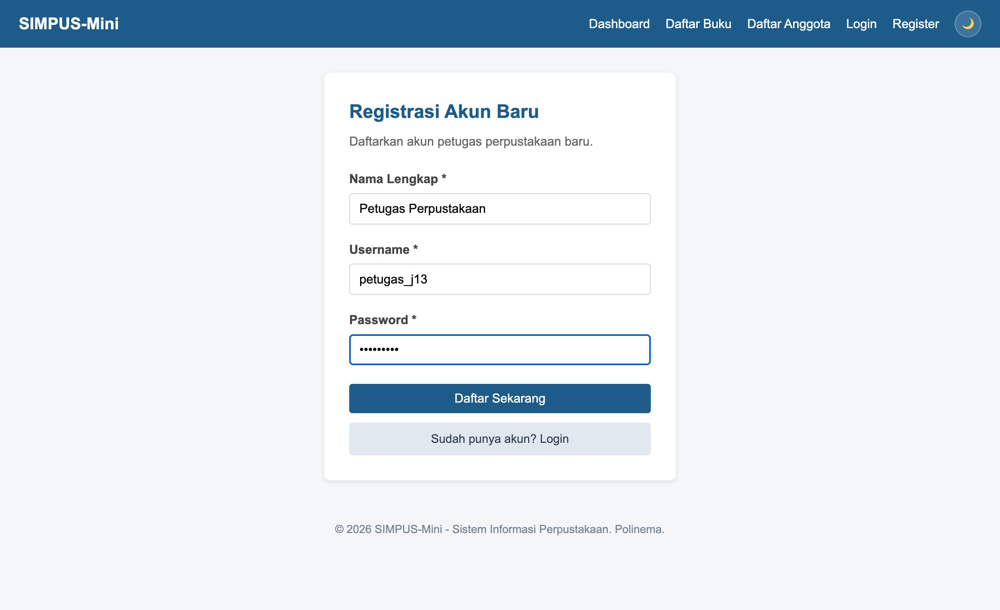
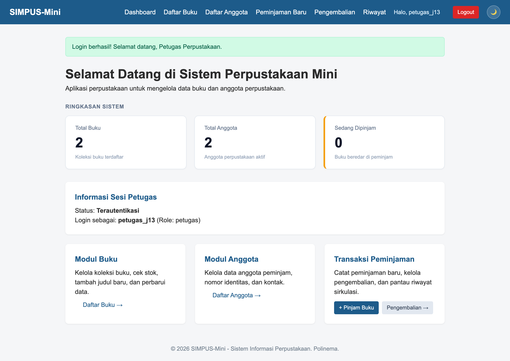
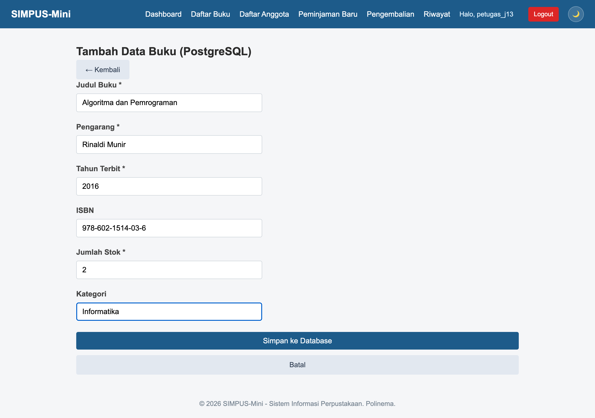
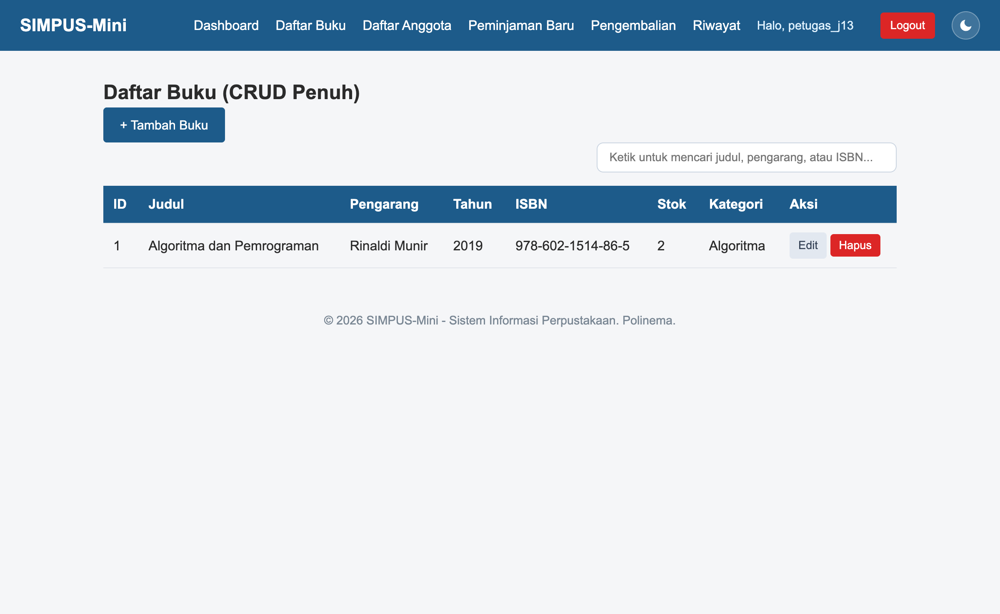
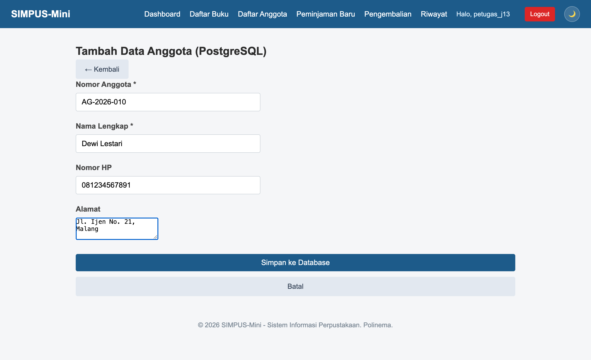
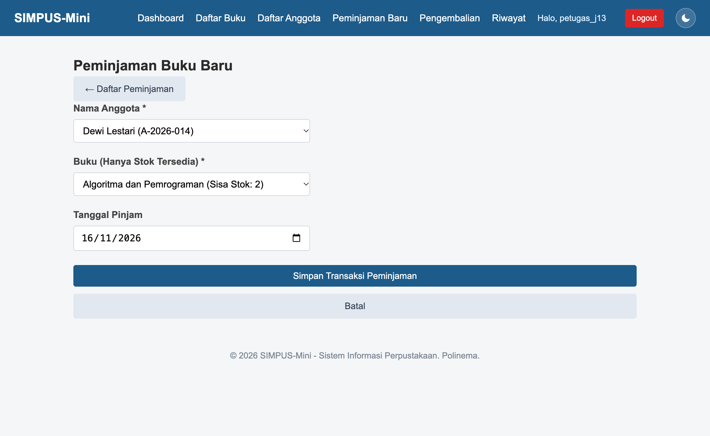

# Manual Pengguna — SIMPUS-Mini

> Catatan: dokumen ini berisi langkah bertekstur lengkap sebagai pengganti tangkapan layar. Sisipkan screenshot nyata pada tiap langkah bertanda **[Screenshot]** saat didemokan.
>
> URL contoh di bawah pakai `http://localhost:8000/...` (PHP built-in server). Kalau menjalankan lewat Laragon, sesuaikan jadi `http://jobsheet13.test/...` (virtual host langsung) atau `http://dp2026.test/kode-praktikum/jobsheet-13/...` (bersarang di bawah domain proyek) — path selanjutnya di tiap langkah sama persis, tinggal ganti bagian domainnya saja.
Panduan ini mengikuti tampilan aplikasi apa adanya. Setiap langkah yang membutuhkan
tangkapan layar disertai gambar dari aplikasi yang benar-benar dijalankan pada 16 November 2026.

## 1. Registrasi & Login Petugas
URL contoh memakai `http://localhost:8000/...` (PHP built-in server). Bila dijalankan lewat
Laragon, ganti bagian domainnya saja: `http://jobsheet13.test/...` untuk virtual host langsung,
atau `http://dp2026.test/kode-praktikum/jobsheet-13/...` bila bersarang di bawah domain proyek.
Path setelah domain tetap sama.

## 1. Registrasi dan Login Petugas

1. Buka `http://localhost:8000/auth/register.php`.
2. Isi Nama, Username, Password (minimal 6 karakter), klik **Daftar**. **[Screenshot: form registrasi]**
3. Setelah berhasil, akan diarahkan ke halaman Login. Masukkan username & password yang baru dibuat, klik **Masuk**. **[Screenshot: form login]**
4. Setelah berhasil login, navbar menampilkan nama petugas dan tombol **Logout**, serta menu tambahan (Tambah Buku, Daftar/Tambah Anggota, Peminjaman) yang tidak terlihat oleh Tamu. **[Screenshot: navbar setelah login]**
2. Isi Nama Lengkap, Username, dan Password (minimal 6 karakter), lalu klik **Daftar Sekarang**.

   

3. Setelah berhasil, aplikasi mengarahkan ke halaman Login dengan pesan "Registrasi akun
   berhasil. Silakan login." Masukkan username dan password yang baru dibuat, lalu klik **Masuk**.

   

4. Navbar berubah: muncul menu Peminjaman Baru, Pengembalian, dan Riwayat, nama petugas di
   kanan, serta tombol Logout. Menu itu tidak terlihat oleh tamu yang belum login.

   

## 2. Mengelola Data Buku

1. Klik menu **Tambah Buku**, isi Judul, Pengarang, Tahun, ISBN, Stok, Kategori, klik **Simpan**. **[Screenshot: form tambah buku]**
2. Buku baru langsung tampil di **Daftar Buku**. Gunakan kolom pencarian untuk menyaring berdasarkan judul. **[Screenshot: daftar buku]**
3. Klik **Edit** pada baris buku untuk mengubah data, atau **Hapus** untuk menghapus (akan muncul konfirmasi sebelum data benar-benar dihapus).
1. Buka menu **Daftar Buku**, lalu klik **+ Tambah Buku**. Isi Judul, Pengarang, Tahun, ISBN,
   Stok, dan Kategori, kemudian klik **Simpan ke Database**.

   

2. Buku baru langsung tampil di Daftar Buku. Kolom pencarian di kanan atas menyaring baris
   berdasarkan judul, pengarang, atau ISBN.

   

3. Tombol **Edit** pada tiap baris membuka form perubahan data. Tombol **Hapus** meminta
   konfirmasi lebih dulu; penghapusan buku yang sudah punya riwayat peminjaman akan ditolak
   database, karena tabel `peminjaman` merujuk `buku` tanpa `ON DELETE CASCADE`.

## 3. Mengelola Data Anggota

Alurnya sama dengan Buku: menu **Tambah Anggota** → isi form → tampil di **Daftar Anggota** → Edit/Hapus tersedia per baris.
1. Buka menu **Daftar Anggota**, lalu klik **+ Tambah Anggota**. Nomor Anggota wajib diisi dan
   harus unik; Nama Lengkap wajib diisi; Nomor HP dan Alamat opsional.

   

2. Anggota baru tampil di daftar dan langsung tersedia pada pilihan peminjaman.

   

## 4. Meminjamkan Buku

1. Klik menu **Peminjaman Baru**.
2. Pilih **Anggota** dan **Buku** (hanya buku dengan stok tersedia yang muncul di pilihan), klik **Simpan Peminjaman**. **[Screenshot: form peminjaman]**
3. Kembali ke **Beranda** — kartu "Sedang Dipinjam" bertambah, dan stok buku terkait di **Daftar Buku** berkurang 1.
1. Buka menu **Peminjaman Baru**.
2. Pilih Anggota dan Buku. Dropdown buku hanya memuat judul dengan stok tersedia, dan angka
   sisa stok ditulis pada setiap pilihan. Tanggal pinjam terisi hari ini dan boleh diubah.
   Klik **Simpan Transaksi Peminjaman**.

   

3. Setelah tersimpan, aplikasi kembali ke daftar peminjaman aktif dengan pesan berhasil.
   Stok buku berkurang satu, dan kartu "Sedang Dipinjam" di Beranda bertambah satu.

Aturan yang berlaku saat menyimpan:

- Buku dengan stok 0 ditolak meski dipilih lewat permintaan langsung.
- Anggota yang masih menahan buku lebih dari 14 hari ditolak sampai pinjaman lamanya
  dikembalikan.

## 5. Mengembalikan Buku

1. Klik menu **Pengembalian**.
2. Cari transaksi berdasarkan nama anggota atau judul buku (opsional), lalu klik **Kembalikan** pada baris yang sesuai. **[Screenshot: daftar pengembalian]**
3. Stok buku terkait bertambah kembali 1, dan transaksi hilang dari daftar peminjaman aktif.
1. Buka menu **Pengembalian**. Daftar hanya berisi transaksi berstatus Dipinjam.
2. Gunakan kolom pencarian untuk menyaring berdasarkan nama anggota atau judul buku, lalu klik
   **Kembalikan** pada baris yang sesuai dan setujui konfirmasi.

   

3. Stok buku bertambah kembali satu, transaksi hilang dari daftar aktif, dan tanggal kembali
   terisi tanggal hari ini. Menekan Kembalikan dua kali untuk transaksi yang sama ditolak.

## 6. Melihat Riwayat Peminjaman

1. Klik menu **Riwayat**.
2. Pilih nama anggota dari dropdown, klik **Tampilkan**.
3. Tabel menampilkan seluruh riwayat peminjaman anggota tersebut beserta status (Dipinjam/Selesai). **[Screenshot: riwayat peminjaman]**
1. Buka menu **Riwayat**.
2. Pilih nama anggota pada dropdown untuk menyaring, atau biarkan "-- Semua Anggota --" untuk
   melihat seluruh transaksi. Penyaringan berjalan saat pilihan berubah, tanpa tombol tambahan.
3. Tabel menampilkan anggota, buku, tanggal pinjam, tanggal kembali, dan status
   (Dipinjam atau Dikembalikan). Baris tanpa tanggal kembali berarti buku belum kembali.

   

## 7. Logout

Klik **Logout** di navbar kanan atas untuk mengakhiri sesi. Setelah logout, menu-menu yang membutuhkan login (Tambah Buku, Anggota, Peminjaman) akan hilang dari navbar dan halamannya tidak bisa diakses langsung (otomatis diarahkan ke halaman Login).
Klik **Logout** di kanan atas. Sesi berakhir dan aplikasi kembali ke halaman Login. Menu yang
membutuhkan login hilang dari navbar, dan membuka halaman modul secara langsung akan
dialihkan ke halaman Login.

